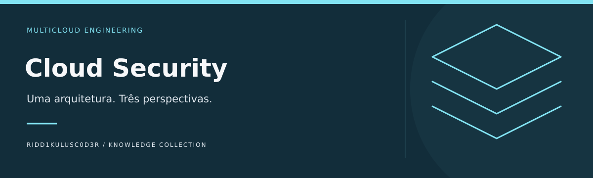

# Cloud Security

**Uma arquitetura. Três perspectivas.**

Organizar fundamentos e estudos comparativos de segurança em AWS, Azure e Google Cloud, começando por identidade, logs, rede, dados e responsabilidade compartilhada.

[Comece aqui](docs/COMECE-AQUI.md) · [Referências comentadas](docs/REFERENCIAS.md) · [Identidade visual](docs/IDENTIDADE-VISUAL.md) · [Caso guiado](examples/caso-01.md) · [Modelo de trabalho](templates/ficha.md)

## Objetivo e fronteiras

É a base multicloud. Azure concentra implementação Microsoft. Correspondência de serviços não significa equivalência de permissões, logs ou comportamento.

## Caminhos de uso

| Etapa | Pergunta de trabalho | Entrega |
|---|---|---|
| Arquitetar | Modelar ativos e fronteiras de confiança | Diagrama e responsabilidades |
| Comparar | Descrever controles por provedor | Matriz de diferenças |
| Verificar | Definir evidência de aplicação do controle | Plano de validação e custos |

## Começar

1. Leia o [guia de entrada](docs/COMECE-AQUI.md).
2. Escolha uma [referência pelo problema](docs/REFERENCIAS.md), não pela popularidade.
3. Resolva o [caso sintético](examples/caso-01.md) e registre sua análise na [ficha](templates/ficha.md).

## Estado atual

Base documental inicial com objetivos, referências comentadas, modelo de trabalho e um exercício de mesa sintético. O caso é resolvido por leitura e análise; não há ambiente executável, integração ativa ou validação em produção nesta entrega.

## Contribuir

Inclua problema resolvido, fonte original, data, limitações e condições de reutilização. Diferencie observação, interpretação e hipótese. Recursos externos permanecem sujeitos às licenças e condições dos respectivos autores.

## Conexões no portfólio

[Azure](https://github.com/Ridd1kulusC0d3r/Azure) · [AppSec](https://github.com/Ridd1kulusC0d3r/AppSec) · [Threat-Modeling](https://github.com/Ridd1kulusC0d3r/Threat-Modeling)

As fronteiras acima definem a direção deste projeto; links relacionados não significam integrações implementadas.

[Matriz de avaliação multicloud](docs/MATRIZ-MULTICLOUD.md)
